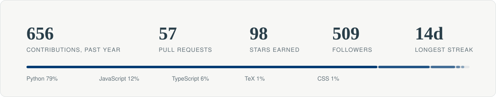

<picture>
  <source media="(prefers-color-scheme: dark)" srcset="assets/header-dark.svg">
  
</picture>

I build [Floqer](https://floqer.com). Along the way I learn and read a lot of database and query engine code.

### Open source

| Project | What I did | Status |
| --- | --- | --- |
| [Apache Iceberg, PyIceberg](https://github.com/apache/iceberg-python) | `create_branch` and `create_tag` silently overwrote an existing ref and orphaned its commits. Added the existence, kind and `main` guards the Java implementation has, with tests. | Merged, [#4319](https://github.com/apache/iceberg-python/pull/4319) |
| [DuckDB Node client](https://github.com/duckdb/duckdb-node-neo) | `Symbol.dispose` on every class with an explicit close, so `using` releases results, statements, appenders and connections on every way out of a scope. Bindings for the config option C API: define a custom setting, register it, read any setting back with its scope. Bindings for the copy function C API, so a `COPY TO` format or a `COPY FROM` reader can be written in JavaScript. | Merged, [#530](https://github.com/duckdb/duckdb-node-neo/pull/530) and [#531](https://github.com/duckdb/duckdb-node-neo/pull/531). In review, [#548](https://github.com/duckdb/duckdb-node-neo/pull/548) |
| [HydraDB](https://github.com/hydra-db/hydradb) | Found that the experimental Cypher engine sorted aggregated results by a dropped variable; fixed in v0.4.0. Then found the new check rejects a valid openCypher TCK query and reported that with the exact scenario. | Reported, [#313](https://github.com/hydra-db/hydradb/issues/313) and [#325](https://github.com/hydra-db/hydradb/issues/325) |
| [postsmith](https://github.com/deepdave98/postsmith) | Writes LinkedIn and X posts in your voice from a corpus you supply. | Maintainer |

### Stats

<picture>
  <source media="(prefers-color-scheme: dark)" srcset="assets/stats-dark.svg">
  
</picture>

### Reach me

[LinkedIn](https://www.linkedin.com/in/deepdave007/) · [deepajaydave@gmail.com](mailto:deepajaydave@gmail.com) · [deepdave.co](https://www.deepdave.co)
