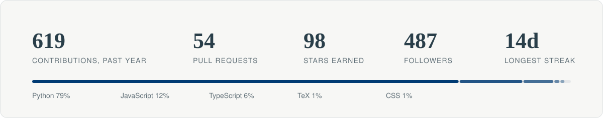

<picture>
  <source media="(prefers-color-scheme: dark)" srcset="assets/header-dark.svg">
  
</picture>

I build [Floqer](https://floqer.com). Along the way I read a lot of database and query engine code.

### Open source

| Project | What I did | Status |
| --- | --- | --- |
| [Apache Iceberg, PyIceberg](https://github.com/apache/iceberg-python) | `create_branch` and `create_tag` silently overwrote an existing ref and orphaned its commits. Added the existence, kind and `main` guards the Java implementation has, with tests. | Merged, [#4319](https://github.com/apache/iceberg-python/pull/4319) |
| [HydraDB](https://github.com/hydra-db/hydradb) | Found that the experimental Cypher engine accepts `ORDER BY` on a binding an aggregating or `DISTINCT` `RETURN` has dropped and sorts by an arbitrary row. Fix with tests ready on my fork. | Reported, [#313](https://github.com/hydra-db/hydradb/issues/313) |
| [postsmith](https://github.com/deepdave98/postsmith) | Writes LinkedIn and X posts in your voice from a corpus you supply. | Maintainer |

### Stats

<picture>
  <source media="(prefers-color-scheme: dark)" srcset="assets/stats-dark.svg">
  
</picture>

### Reach me

[LinkedIn](https://www.linkedin.com/in/deepdave007/) · [deepajaydave@gmail.com](mailto:deepajaydave@gmail.com) · [deepdave.co](https://www.deepdave.co)
